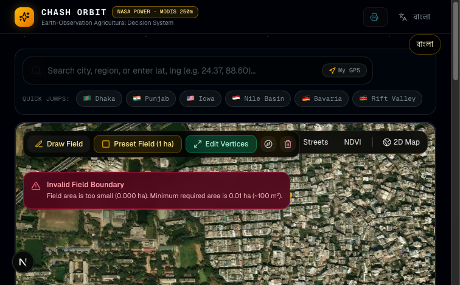
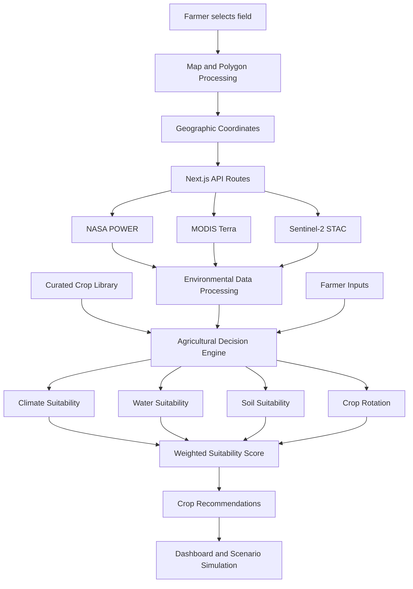

# 🌍 Chash Orbit — From Space Data to Smarter Farming

**An Earth-to-Farm Agricultural Decision Support System | NASA Space Apps Challenge 2026**

Chash Orbit transforms satellite observations, climate data, agricultural research, and farm-specific information into actionable insights for farmers.

By combining NASA Earth observation data with a transparent, rule-based agricultural decision engine, Chash Orbit helps farmers understand their land, evaluate crop suitability, identify environmental risks, and make more informed planting decisions.

**Our mission:** Make Earth science accessible and useful to the people who depend on the land.

<p align="center">
  
</p>

**Live Application:** https://chash-orbit.vercel.app/  
**GitHub Repository:** https://github.com/Owasiul/Chash_Orbit

---

## 1. The Problem We Are Solving

Agriculture is increasingly affected by unpredictable rainfall, rising temperatures, soil degradation, droughts, and changing growing seasons.

For smallholder farmers, especially in Bangladesh, making agricultural decisions is difficult because:

- Traditional planting calendars cannot always account for changing climate conditions.
- Farmers often lack access to reliable, location-specific environmental information.
- Excessive irrigation can increase groundwater pressure and farming costs.
- Selecting unsuitable crops can lead to reduced productivity and financial losses.
- Satellite observations and scientific agricultural datasets are difficult to interpret without technical knowledge.

NASA satellites continuously observe Earth's atmosphere, land, vegetation, and water systems. However, raw scientific observations are rarely presented in a format that helps an individual farmer decide what to plant.

**Chash Orbit bridges this gap by translating environmental observations into understandable agricultural recommendations.**

## 2. How Chash Orbit Works

Chash Orbit follows an Earth-to-Farm data-processing pipeline.

1. **Select a farm:** The user draws a field boundary on the interactive map or loads a demonstration field.
2. **Identify the study area:** The system calculates the field's geographic coordinates, centroid, bounding box, and area.
3. **Retrieve Earth observation data:** Next.js API routes request environmental information from NASA and other scientific data providers.
4. **Process environmental conditions:** The system evaluates rainfall, temperature, vegetation health, seasonal variation, and water availability.
5. **Combine agricultural knowledge:** Crop requirements are retrieved from our curated agricultural crop library, informed by BARI, BRRI, FAO, and other agricultural research references.
6. **Run the decision engine:** A deterministic scoring model evaluates crop suitability across climate, water, soil, and crop rotation dimensions.
7. **Generate recommendations:** Farmers receive crop suitability scores, environmental risk information, rotation plans, and scenario-based results.

The system distinguishes between observed data, cached observations, calculated indicators, farmer-reported information, and illustrative assumptions.

---

## 3. Earth Observation Data Sources

One of the most important parts of Chash Orbit is its use of real Earth observation and environmental datasets.

We do not simply display satellite imagery. We process environmental variables and use them as inputs to our agricultural decision engine.

### NASA and Satellite Data

| Dataset | Data Provider | Variables / Information | Resolution | Application |
|---|---|---|---|---|
| NASA POWER | NASA Langley Research Center | Precipitation, temperature, and meteorological variables | Approximately 0.5° for relevant meteorological parameters | Climate suitability, rainfall analysis, heat stress, and historical trends |
| MODIS Terra MOD13Q1 | NASA MODIS / ORNL DAAC | NDVI vegetation index | 250 m | Vegetation health and seasonal vegetation patterns |
| Sentinel-2 Level-2A | Copernicus Sentinel-2 via Microsoft Planetary Computer | Multispectral satellite imagery and scene metadata | 10 m for selected bands | High-resolution field visualization and scene discovery |
| GPM IMERG | NASA Global Precipitation Measurement | Satellite-derived precipitation | Not currently integrated as a direct live retrieval | Planned enhancement for precipitation validation and improved rainfall analysis |
| SMAP | NASA Soil Moisture Active Passive | Surface and root-zone soil moisture products | Product-dependent | Planned enhancement for soil moisture validation |

### 3.1 NASA POWER — Climate and Rainfall Analysis

**Source:** https://power.larc.nasa.gov/

NASA POWER provides environmental and meteorological observations and data products that help us understand the climate conditions surrounding a selected farm.

Our implementation uses variables including:

- `PRECTOTCORR` — corrected precipitation.
- Temperature-related parameters for thermal conditions and heat stress.
- Historical meteorological records for seasonal and multi-year comparisons.

**How we use the data:**

- Estimate rainfall patterns over the study area.
- Identify periods of insufficient rainfall.
- Analyze temperature conditions and potential heat stress.
- Calculate rainfall variability and historical trends.
- Provide environmental inputs to crop suitability calculations.

The retrieved data is cached in PostgreSQL through Prisma to reduce repeated requests and improve application performance.

**Important:** NASA POWER precipitation is the current operational rainfall source. It is not a direct GPM IMERG retrieval.

### 3.2 MODIS Terra MOD13Q1 — Vegetation Health

**Source:** https://modis.ornl.gov/

Chash Orbit uses the MODIS Terra MOD13Q1 vegetation index product.

NDVI (Normalized Difference Vegetation Index) helps describe vegetation greenness and its seasonal changes.

The NDVI product has:

- 250-meter spatial resolution.
- 16-day composite intervals.

**How we use it:**

- Observe vegetation conditions across the selected agricultural area.
- Examine seasonal vegetation changes.
- Identify differences in vegetation activity.
- Provide an additional environmental indicator for agricultural assessment.

NDVI is an indicator of vegetation greenness, not a direct measurement of crop yield or plant disease.

### 3.3 Sentinel-2 — Detailed Field Observation

**Source:** https://planetarycomputer.microsoft.com/

We use the Microsoft Planetary Computer STAC catalog to discover Sentinel-2 Level-2A scenes.

Selected Sentinel-2 bands provide imagery at 10-meter resolution.

**How we use it:**

- Discover satellite scenes covering the selected field.
- Support detailed field-level visualization.
- Provide a pathway for future multispectral crop monitoring.

Our current implementation provides scene discovery and references; it should not be interpreted as a fully implemented crop classification or yield-prediction model.

### 3.4 GPM IMERG and SMAP — Planned Data Integration

Two additional NASA missions are relevant to our agricultural monitoring architecture.

**GPM IMERG**

NASA's Global Precipitation Measurement mission provides satellite-based precipitation estimates. Direct IMERG integration would allow us to improve rainfall analysis and compare precipitation estimates with NASA POWER data.

**SMAP**

NASA's Soil Moisture Active Passive mission provides soil moisture observations. Integrating SMAP would help validate our modeled water conditions against satellite-derived soil moisture information.

These are identified as future integrations, not currently operational direct data feeds.

---

## 4. Where Does Our Crop Information Come From?

Satellite data alone cannot determine whether a particular crop is suitable for a particular field.

For that reason, Chash Orbit combines environmental observations with agricultural knowledge.

Our crop library is maintained in:

`src/lib/crops.ts`

It contains crop-specific information such as:

- Crop name and plant family.
- Growing season.
- Approximate water requirements.
- Nitrogen-related crop rotation classification.
- Agronomic suitability information.

### Agricultural Research and Reference Sources

| Organization | Contribution |
|---|---|
| Bangladesh Rice Research Institute (BRRI) | Rice-related agronomic knowledge |
| Bangladesh Agricultural Research Institute (BARI) | Crop-specific agricultural research and cultivation references |
| Food and Agriculture Organization (FAO) | Crop water requirements and irrigation guidance |
| International Crops Research Institute for the Semi-Arid Tropics (ICRISAT) | Knowledge relating to dryland crops and pulses |
| World Vegetable Center (WorldVeg) | Vegetable and horticultural crop references |
| Cotton Development Board (CDB), Bangladesh | Cotton-related agricultural references |

### Crop Library

Our current crop library includes:

| Crop | Growing Season | Approximate Water Requirement |
|---|---|---:|
| Rice | Kharif | 1,100 mm |
| Wheat | Rabi | 450 mm |
| Maize | Kharif | 500 mm |
| Potato | Rabi | 500 mm |
| Tomato | Kharif | 600 mm |
| Chickpea | Rabi | 250 mm |
| Lentil | Rabi | 220 mm |
| Soybean | Kharif | 450 mm |
| Sorghum | Kharif | 300 mm |
| Millet | Kharif | 250 mm |
| Mung Bean | Summer | 200 mm |
| Mustard | Rabi | 280 mm |
| Cotton | Kharif | 600 mm |
| Vegetables | Year-round | 500 mm (illustrative composite) |
| Fruit | Year-round | 700 mm (illustrative composite) |

These values represent the current crop-library parameters, not universal irrigation prescriptions. Actual water requirements depend on crop variety, growth stage, climate, soil, and cultivation practices.

**Important:** Crop information is currently maintained in a curated, structured crop library. We do not claim that every crop parameter is retrieved dynamically from an external agricultural API.

---

## 5. Our Agricultural Decision Engine

The core of Chash Orbit is a deterministic agricultural decision engine.

Unlike a simple information dashboard, the engine processes environmental indicators and crop-specific requirements to produce comparable agricultural suitability scores.

**Core implementation:** `engine.ts` and `crops.ts`

### Four Main Assessment Dimensions

| Dimension | What It Evaluates |
|---|---|
| Climate Suitability | Temperature conditions, rainfall patterns, and seasonal compatibility |
| Water Suitability | Water availability and crop water requirements |
| Soil Suitability | Available soil information, farmer inputs, and regional assumptions |
| Crop Rotation Suitability | Plant families, nitrogen-related classifications, and previous crop sequences |

Each dimension contributes to a combined suitability score between 0 and 100.

The model uses configurable weights based on farmer priorities, including:

- Soil health.
- Water conservation.
- Climate resilience.
- Potential farming income.

The result is a structured comparison of how different crops match the selected field's available environmental and agricultural information.

### What Makes This a Model?

Chash Orbit uses a rule-based, deterministic decision model rather than claiming to have trained a machine-learning model.

Its processing involves:

1. Collecting geographic and environmental inputs.
2. Normalizing relevant environmental indicators.
3. Comparing environmental conditions against crop requirements.
4. Applying agricultural and crop rotation rules.
5. Calculating weighted suitability scores.
6. Producing ranked crop recommendations.

The same inputs and model configuration produce reproducible results.

This makes the decision process explainable and allows farmers and evaluators to understand why one crop receives a higher suitability score than another.

**Our focus is transparent agricultural decision support, not an unsupported claim of AI-powered yield prediction.**

---

## 6. Crop Rotation and Sustainable Agriculture

Continuous cultivation of the same crop family can negatively affect long-term soil health.

Chash Orbit includes a multi-year crop rotation planner that applies agricultural rotation rules.

The current implementation:

- Avoids repeating the same plant family in consecutive years.
- Alternates nitrogen-depleting cereals with nitrogen-fixing legumes.
- Introduces restorative cover crops when soil health is prioritized.
- Considers farmer preferences when generating rotation recommendations.

For example, a cereal-based cultivation plan can be followed by a legume crop to encourage a more balanced crop rotation strategy.

These are decision-support rules, not guarantees of measured soil nitrogen improvement.

---

## 7. Climate Scenario Simulation

Farmers need to understand not only current environmental conditions but also how agricultural decisions might change under different climate conditions.

Chash Orbit includes an interactive scenario-testing feature.

Users can adjust:

- Precipitation changes (for example, -20%).
- Temperature increases (for example, +2°C).

The decision engine recalculates crop suitability scores using the adjusted environmental inputs.

This allows users to compare baseline conditions with hypothetical drought and warming scenarios.

**Example:**

A crop that performs well under normal rainfall conditions may receive a lower suitability score when precipitation decreases.

The purpose is to demonstrate potential vulnerability and support more resilient crop selection.

These simulations are hypothetical scenarios, not official climate forecasts.

---

## 8. Real-World Impact

Chash Orbit is designed to make complex Earth observation data useful at the farm level.

| Agricultural Challenge | How Chash Orbit Helps |
|---|---|
| Uncertain rainfall | Analyzes historical precipitation patterns and seasonal variability |
| Rising temperatures | Identifies thermal conditions and potential heat stress |
| Unsuitable crop selection | Compares crop requirements against available field conditions |
| Water management | Evaluates rainfall and modeled water availability against crop needs |
| Soil degradation | Encourages crop rotation and nitrogen-fixing crop selection |
| Climate uncertainty | Allows farmers to test hypothetical drought and warming scenarios |
| Limited technical knowledge | Presents scientific information through an accessible dashboard |

### Who Benefits?

- **Smallholder farmers:** Better access to environmental information for planting decisions.
- **Agricultural extension workers:** A visual tool for discussing crop suitability and environmental conditions.
- **Researchers and students:** An accessible way to explore how Earth observation data can support agricultural decisions.
- **Agricultural planners:** A framework for evaluating crop choices under different environmental scenarios.

Our long-term vision is to make satellite-informed agricultural decision support accessible to farming communities, particularly in climate-vulnerable regions such as Bangladesh.

---

## 9. Data Reliability and Transparency

We believe an agricultural recommendation should explain where its information comes from.

Chash Orbit uses data provenance labels to distinguish different types of information:

| Label | Meaning |
|---|---|
| LIVE | Retrieved from an external data service |
| CACHED | Previously retrieved information stored for reuse |
| DERIVED | Calculated by our own processing or decision logic |
| REPORTED | Supplied by the farmer or user |
| DEMO | Example or demonstration information |

We also distinguish between satellite observations, gridded climate products, calculated indicators, and agricultural assumptions.

### Current Limitations

We acknowledge several limitations in the current system:

1. **Climate resolution:** NASA POWER meteorological data at approximately 0.5° resolution cannot represent every microclimate within a small farm.
2. **Vegetation resolution:** A 250-meter MODIS pixel can cover multiple small agricultural plots, so its vegetation signal may represent the surrounding agricultural landscape.
3. **Soil information:** Soil assessments currently rely on farmer-reported information and regional heuristics rather than direct field laboratory measurements.
4. **Soil moisture:** Root-zone moisture is modeled using a Hargreaves-Samani potential evapotranspiration water-balance approach, not direct SMAP measurements.
5. **Rainfall integration:** Direct GPM IMERG retrieval and validation are not yet implemented.
6. **Crop parameters:** Some crop requirements are generalized or illustrative and require further local calibration.
7. **Model validation:** Suitability scores are decision-support estimates. They are not yet validated against a large dataset of observed farm yields.

We prefer transparent limitations over presenting estimated values as verified scientific measurements.

---

## 10. System Architecture

Chash Orbit is built using a Next.js architecture without a separate FastAPI backend.



### Technology Stack

| Layer | Technology |
|---|---|
| Framework | Next.js 16 App Router |
| Frontend | React 19, TypeScript |
| Styling | Tailwind CSS 4, shadcn/ui |
| Interactive Maps | MapLibre GL JS, Terra Draw |
| Geographic Calculations | Turf.js |
| State Management | Zustand |
| Database | Neon Serverless PostgreSQL |
| ORM | Prisma |
| AI Assistant | Google Gemini via Vercel AI SDK |
| Deployment | Vercel |

---

## 11. Performance and Demonstration

Chash Orbit includes a demonstration field called **Rajshahi Demo Field**.

The example represents a 2.73-hectare rice-farming parcel in Rajshahi, Bangladesh.

It allows judges and visitors to explore the dashboard without having to draw a field manually.

The application also includes:

- Interactive satellite polygon mapping.
- Automatic field area and centroid calculations.
- Cached environmental observations.
- Crop suitability comparisons.
- Crop rotation planning.
- Climate scenario testing.
- English and Bengali interfaces.
- Printable field reports.
- An AI assistant grounded in structured decision-engine results.

---

## 12. Future Development

Our next development priorities include:

| Planned Integration | Expected Improvement |
|---|---|
| NASA GPM IMERG | Direct satellite precipitation retrieval and rainfall validation |
| NASA SMAP | Satellite soil moisture observations and model validation |
| SoilGrids | Soil texture, organic carbon, and other soil-property information |
| Additional NASA POWER variables | Expanded meteorological and agricultural indicators |
| Local crop calibration | Better crop requirements for Bangladesh-specific varieties |
| Field-level validation | Compare recommendations with observed farm conditions and yields |
| Machine-learning research | Explore validated predictive models when sufficient training data becomes available |

These improvements will strengthen the reliability and geographical relevance of our agricultural recommendations.

---

## 13. Installation and Local Development

### Prerequisites

- Node.js 20.9 or newer.
- npm 10 or newer.
- PostgreSQL database (Neon recommended).

### Clone the Repository

```bash
git clone https://github.com/Owasiul/Chash_Orbit.git
cd Chash_Orbit
npm install
```

### Configure Environment Variables

Create a `.env` file using the example configuration:

```env
DATABASE_URL="your_neon_postgresql_connection_string"

GOOGLE_GENERATIVE_AI_API_KEY="your_gemini_api_key"

GEMINI_MODEL="gemini-2.0-flash-lite"
```

The Gemini API key is optional. The application can use its deterministic decision generator when the AI assistant is not configured.

### Initialize the Database

```bash
npm run db:push
```

### Run the Development Server

```bash
npm run dev
```

Open:

http://localhost:3000

### Available Commands

| Command | Description |
|---|---|
| `npm run dev` | Start development server |
| `npm run build` | Build production application |
| `npm start` | Start production server |
| `npm run lint` | Run ESLint |
| `npm test` | Run automated tests |
| `npm run warm-cache` | Pre-warm environmental data cache |
| `npm run db:push` | Synchronize Prisma database schema |
| `npm run db:generate` | Generate Prisma client |

---

## 14. Our Vision

Earth observation should not remain limited to researchers, scientists, and technical institutions.

The same satellite observations that help us understand Earth's changing environment can also help farmers make more informed decisions about their land.

With Chash Orbit, we are bringing NASA Earth science, agricultural research, and transparent computational models together in one accessible platform.

**From satellite observations to field-level understanding. From environmental data to smarter agricultural decisions.**

**Chash Orbit — Helping Farmers Make Data-Informed Decisions, One Field at a Time.** 🌍🛰️

---

## Acknowledgments and Data References

- [NASA POWER](https://power.larc.nasa.gov/)
- [NASA Global Precipitation Measurement (GPM)](https://gpm.nasa.gov/)
- [NASA Soil Moisture Active Passive (SMAP)](https://smap.jpl.nasa.gov/)
- [NASA MODIS](https://modis.gsfc.nasa.gov/)
- [ORNL DAAC MODIS Subsetting Service](https://modis.ornl.gov/)
- [FAO — Irrigation and Drainage Paper 56](https://www.fao.org/4/x0490e/x0490e00.htm)


